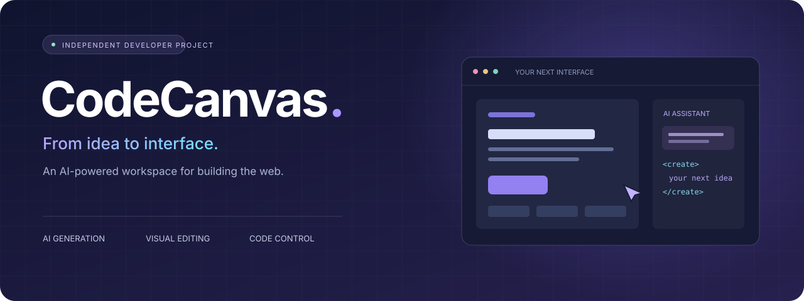
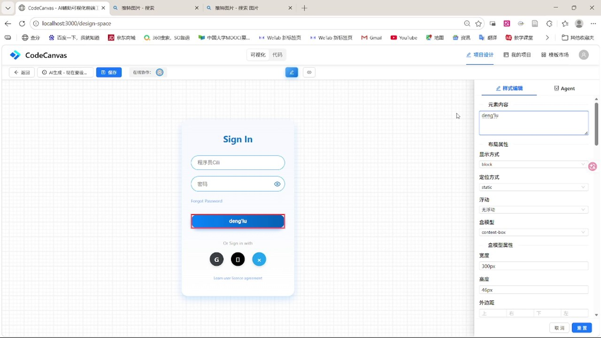
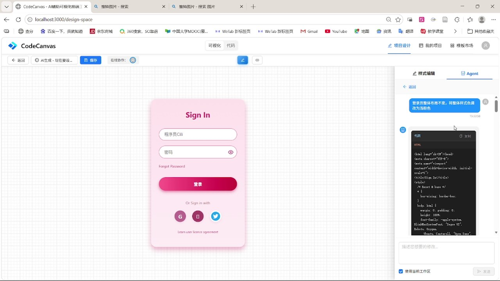
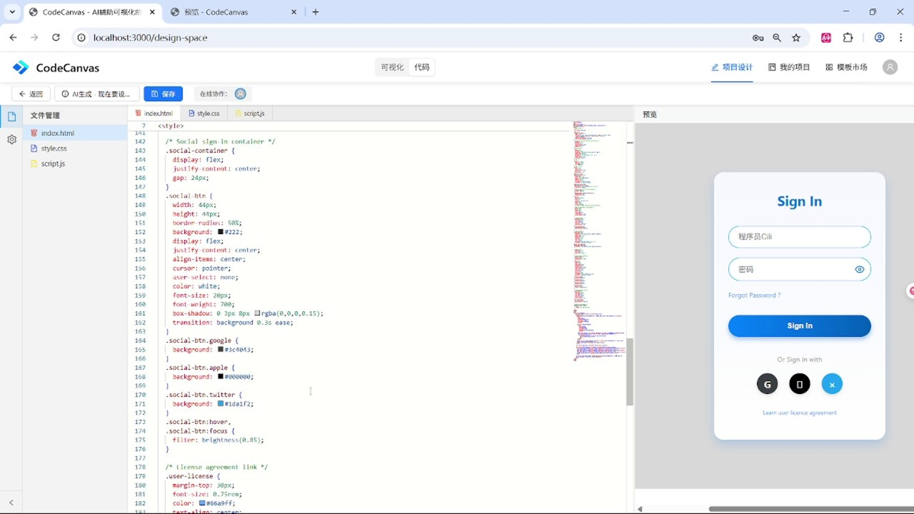
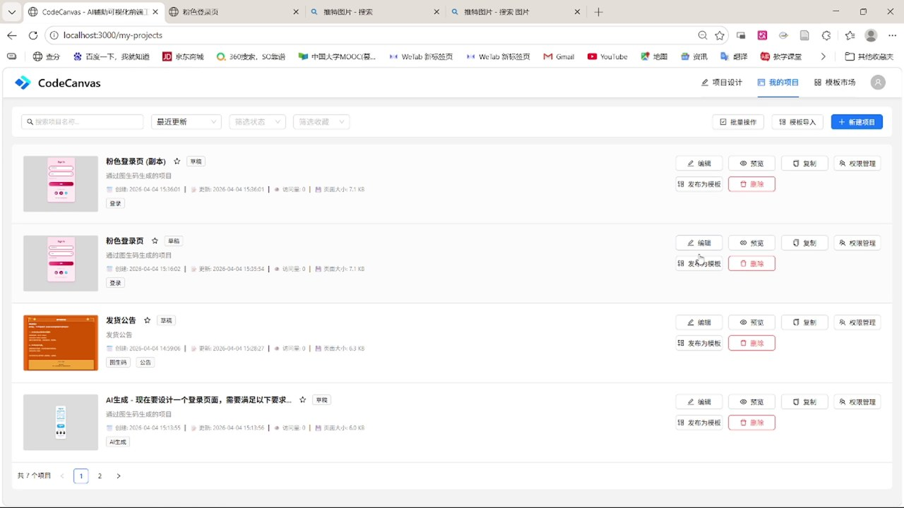

<div align="center">



### 让灵感成为页面。

一个融合 **AI 生成、可视化编辑与代码创作** 的前端工作台。<br />
从参考图到页面初稿，从自然语言到细节调整，把创意留在同一张画布上。

**React · TypeScript · Monaco Editor · Express · MySQL**

[▶ 观看完整演示](introduce/完整演示视频.mp4) &nbsp; · &nbsp; [探索功能](#产品能力) &nbsp; · &nbsp; [技术设计](#技术设计) &nbsp; · &nbsp; [本地运行](#本地运行)

</div>

<br />

## 一个想法，多种创作方式

**CodeCanvas 是我开发的 AI 辅助前端创作工具。** 我希望让页面搭建形成一段连续的体验：从图片、文字或模板出发，借助 AI 生成初稿，在画布中微调视觉效果，再进入代码视图完成更精确的修改。

创作的起点可以不同，编辑过程始终围绕同一个页面展开。生成结果可以继续修改，细节可以反复尝试，进展可以保存为项目与历史版本。

> **描述想法 → 生成页面 → 对话迭代 → 视觉微调 → 代码精修 → 保存作品**

[](introduce/完整演示视频.mp4)

<p align="center"><sub>实际运行画面 · 点击图片观看完整演示</sub></p>

## 产品能力

<table>
<tr>
<td width="50%" valign="top">

### ✦ AI 图生码

上传参考图，补充需求描述，通过多模态模型生成页面初稿。让一个视觉灵感，成为可以预览与继续编辑的 HTML、CSS 和 JavaScript。

[查看演示 →](introduce/AI图生码.mp4)

</td>
<td width="50%" valign="top">

### ✦ 对话式迭代

用自然语言提出调整需求，结合当前代码辅助修改页面。配合项目上下文查询，让交流围绕眼前的作品展开。

[查看演示 →](introduce/AI%20Agent%20对话辅助.mp4)

</td>
</tr>
<tr>
<td width="50%" valign="top">

### ◈ 可视化微调

直接选中预览中的页面元素，在属性面板调整文字、颜色、尺寸、间距和边框。把细节的变化呈现在画布上。

[查看演示 →](introduce/可视化微调演示.mp4)

</td>
<td width="50%" valign="top">

### ⌘ 代码自由编辑

内置 Monaco Editor，编辑 HTML、CSS 与 JavaScript，并在旁边查看页面效果。从快速试验到精确修改，自由切换创作方式。

[查看演示 →](introduce/代码模式编辑.mp4)

</td>
</tr>
<tr>
<td width="50%" valign="top">

### ▦ 模板快速开始

浏览、筛选并导入页面模板，以已有布局作为新的起点，再通过 AI、画布与代码塑造自己的页面。

[查看演示 →](introduce/从模板市场导入项目.mp4)

</td>
<td width="50%" valign="top">

### ↺ 项目与版本管理

集中组织页面作品，保存内容，查看版本差异与回滚历史；支持账号管理与项目协作者，留住每一次迭代。

[查看演示 →](introduce/项目管理.mp4)

</td>
</tr>
</table>

## 看见创作过程

### 用对话推动页面变化

描述配色、布局或内容需求，在 AI Agent 面板中继续完善当前页面，让初稿逐步接近你的想法。



### 用代码掌握实现细节

代码区与预览区并排呈现，便于在修改时观察效果，也为进一步完善交互与样式保留空间。



### 将尝试沉淀为作品

在项目列表中组织不同创意，通过保存、历史版本与差异对比记录变化，让每个页面都有可追溯的创作过程。



## 技术设计

这个项目将 AI 服务接入、浏览器内编辑、可视化交互与后端项目管理串联起来。它既关注页面能否快速生成，也关注生成之后如何继续创作。

| 设计方向 | 实现方式 |
| --- | --- |
| **统一创作空间** | React + MobX 组织工作台交互与编辑状态，衔接可视化模式和代码模式 |
| **浏览器内代码编辑** | Monaco Editor 提供 HTML、CSS、JavaScript 的编辑体验，搭配页面预览 |
| **AI 请求适配** | 对接多模态输入、文本对话与流式输出，适配 Messages / Chat Completions 协议 |
| **项目上下文** | 结合项目代码查询与项目内关键词检索，为对话提供相关信息 |
| **作品持久化** | Express + Sequelize + MySQL 管理用户、项目、模板、版本与聊天记录 |
| **身份与协作** | JWT 身份认证、项目协作者管理与 Socket.IO 实时事件通信 |
| **工程组织** | TypeScript 前后端开发，Vite 构建，独立服务与统一开发命令 |

### 技术栈

| 前端 | 后端 |
| --- | --- |
| React 18 · TypeScript · Vite 5 | Node.js · Express · TypeScript |
| Ant Design 5 · Sass · React Router | Sequelize · MySQL |
| MobX · Monaco Editor | JWT · bcryptjs · Multer |
| Socket.IO Client | Socket.IO |

## 演示录像

**43 秒完整演示，快速了解 CodeCanvas。**

| 视频 | 内容 | 时长 |
| --- | --- | --- |
| [▶ 完整演示](introduce/完整演示视频.mp4) | 浏览主要功能与完整操作流程 | 约 43 秒 |
| [AI 图生码](introduce/AI图生码.mp4) | 从参考图片到页面初稿 | 约 12 秒 |
| [AI Agent 对话辅助](introduce/AI%20Agent%20对话辅助.mp4) | 自然语言驱动页面迭代 | 约 14 秒 |
| [可视化微调](introduce/可视化微调演示.mp4) | 选择元素并调整样式 | 约 5 秒 |
| [代码模式编辑](introduce/代码模式编辑.mp4) | 编辑代码与预览页面 | 约 10 秒 |
| [模板导入](introduce/从模板市场导入项目.mp4) | 从现有布局开启创作 | 约 11 秒 |
| [项目管理](introduce/项目管理.mp4) | 组织与管理页面作品 | 约 57 秒 |
| [登录与注册](introduce/登录与注册.mp4) | 账号入口与注册流程 | 约 22 秒 |

<sub>截图来自实际运行录屏，公开版录屏中的账户隐私字段已作遮盖处理。GitHub 文件页若无法播放视频，可下载 MP4 观看；不同录制版本的界面名称可能略有差异。</sub>

## 本地运行

需要 **Node.js 18+、npm、MySQL 8**。AI 功能需要自行配置兼容模型服务。

```bash
git clone https://github.com/jiefengdelutai/codecanvas.git
cd codecanvas
npm run install:all
```

1. 创建数据库：

   ```sql
   CREATE DATABASE codecanvas CHARACTER SET utf8mb4 COLLATE utf8mb4_unicode_ci;
   ```

2. 复制 `backend/env.example` 为 `backend/.env`，填写数据库连接与自定义 `JWT_SECRET`，创建 `backend/uploads/` 目录。
3. 复制 `frontend/.env.example` 为 `frontend/.env.local`，填写 `VITE_AI_API_KEY`。在 `frontend/src/services/aiService.ts` 的 `AI_API_CONFIG` 中按所用服务调整接口地址和模型列表。
4. 在根目录运行 `npm run dev`，打开 **<http://localhost:3000>**。

后端默认运行在 `5000` 端口，前端通过 `/api` 代理访问业务服务。

<details>
<summary><strong>开发命令与运行说明</strong></summary>

| 命令 | 用途 |
| --- | --- |
| `npm run dev` | 同时启动前后端 |
| `npm run dev:frontend` | 单独启动前端 |
| `npm run dev:backend` | 单独启动后端 |
| `npm run build` | 构建前后端 |
| `npm start` | 启动编译后的后端 |

- 建议使用独立开发数据库，启动时会同步数据表结构。首次初始化空数据库时会创建本地演示账号 `admin / admin123`、`testuser / test123`，也支持注册新账号。
- 当前 AI 请求从浏览器发出，`VITE_` 变量会进入构建产物。公网部署前应将模型请求与密钥管理迁移至服务端。
- 前端构建产物位于 `frontend/dist/`，后端位于 `backend/dist/`；生产部署需要配置前端静态资源服务及 API 代理。
- 后端健康检查：<http://localhost:5000/health>。

</details>

<details>
<summary><strong>当前版本的实现范围</strong></summary>

- 页面 AI 生成与对话通过前端模型适配器调用外部服务；后端图生码接口仍包含模拟实现。
- 项目内检索采用关键词匹配。模板推荐逻辑已包含在服务中，页面默认关闭推荐排序。
- 外部托管平台的自动发布尚未接入，部署接口目前使用模拟地址。

</details>

---

<div align="center">

### 让下一次创作，从 CodeCanvas 开始。

由 [Rice!](https://github.com/jiefengdelutai) 开发与维护 · [MIT License](LICENSE)

欢迎通过 [Issue](https://github.com/jiefengdelutai/codecanvas/issues) 交流想法，也欢迎提交改进。

[观看演示](introduce/完整演示视频.mp4) &nbsp; / &nbsp; [浏览代码](frontend/src)

</div>
